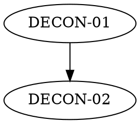

# <Project> <Subsystem>: How It Works (MANIFEST)

**Source:** [`<owner/repo>`](<repo-url>) at commit [`<full-sha>`](<repo-url>/commit/<full-sha>) (<YYYY-MM-DD>)
**Mode:** specific
**Scope:** <what this pack covers; for a scoped run, say "This is a scoped
run. The rest of <project> is not deconstructed here." Link the file or
feature that motivated the run, if there is one.>
**Generated by:** the /deconstruct skill (specific mode)
**What this is:** <N> epics that explain how <project> <does the thing>.
Each epic gives the rules, then a **How <project> does it** walkthrough with
excerpts from the source, then **Code references** linked to the files at
line anchors. The golden vectors under `vectors/` were produced by running
that code (see [`vectors/README.md`](vectors/README.md)). Where the code and
its design document ([`<design doc>`](<rel path>)) disagree, a spec decision
(SD-NN) records the disagreement and which side the vectors follow.
**New to <project>?** [`README.md`](README.md) tells the same story in plain
words and defines the words the epics use. Each epic also opens with an
**In plain words** section.

**Reading order:** [DECON-01](DECON-01_Name.md) (<why first>) →
[DECON-02](DECON-02_Name.md) (<…>) → …

## Goal
<!-- One paragraph: what this subsystem lets a user do, and the one idea
that holds it together. -->

## Epics & build order
| # | Epic | Scope (one line) | Depends on |
|---|---|---|---|
| 01 | [`DECON-01_Name.md`](DECON-01_Name.md) | <scope> | none |

## Perspectives taxonomy
| Perspective | Rating | Evidence | Boundary invariant |
|---|---|---|---|
| <Actor> *(god-mode)* | Full/Partial/Absent | <evidence, linking epics> | <invariant> |
| <Actor> *(administrative)* | … | … | … |
| <Actor> *(user/client)* | … | … | … |
| <Actor> *(observer/operator)* | … | … | … |
| Performant *(lens)* | … | … | Characteristic, informative ([SD-01](MANIFEST.md#spec-decisions-index)) |
| Flexibility *(lens)* | … | … | Characteristic, informative ([SD-01](MANIFEST.md#spec-decisions-index)) |

## Coverage
| Observable behavior | Epic | Notes |
|---|---|---|
<!-- Every public behavior of the scope maps to an epic or to Out of scope.
Link SDs in Notes. -->

## Out of scope
| Item | Why |
|---|---|

## Spec decisions index
| ID | Epic | Decision |
|---|---|---|
| [SD-01](MANIFEST.md#spec-decisions-index) | none | Quality-lens findings are informative. None is binding |
| [SD-02](DECON-01_Name.md#sd-02) | 01 | <decision> |

## Drift log
<!-- Update mode only: | commit range | behavior change | epics touched | -->
